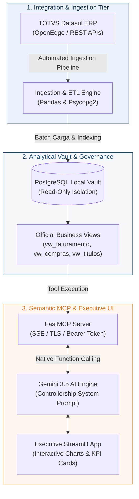

# Enterprise ERP AI Copilot — Controllership & Decision Intelligence Platform

[](https://www.python.org/)
[](https://www.postgresql.org/)
[](https://streamlit.io/)
[-blueviolet.svg)](https://modelcontextprotocol.io/)
[](https://ai.google.dev/)
[](https://www.totvs.com/)
[](LICENSE)

> **Confidentiality & Showcase Notice:** This repository is an open-source, white-label demonstration version prepared for technical portfolio and recruitment review. All proprietary corporate records, corporate identifiers, employee personal data, and internal network endpoints have been sanitized and replaced with generated industrial mock datasets complying with Brazilian LGPD regulations.

---

## 1. Executive Summary

In enterprise manufacturing environments, corporate decision-making is often hindered by fragmented reporting: controllership and board teams routinely spend hundreds of hours manually extracting disjointed spreadsheets from legacy ERPs (such as **TOTVS Datasul**), reconciling broken formulas, and dealing with outdated indicators.

This project delivers an end-to-end **AI-Powered Decision Support & Controllership Copilot**. It bridges legacy ERP transactional data into a high-performance local analytical vault, exposing business metrics through **Model Context Protocol (FastMCP)** tools to a conversational **Generative AI Assistant (Gemini 3.5)** with native Function Calling.

### Key Business Outcomes
- **Sub-Second Analytical Queries:** Pre-aggregated SQL views allow querying multi-year industrial datasets in under 800ms.
- **Natural Language Decision Support:** Executives can ask complex business questions in plain Portuguese and receive rigorously formatted tables, totals, and interactive charts instantly.
- **Strict Controllership Compliance:** Automated rules enforce official fiscal CFOP filtering, forecast exclusion in debt valuation, proportional leave accruals, and emission-date accounting standards.
- **Zero Risk to Production:** Read-only operational model with zero performance degradation or write lockups on the production ERP.

---

## 2. Solution Architecture

The system is architected across three decoupled tiers designed for high availability, security, and sub-second latency:



---

## 3. Core Technical Features

### 1. Model Context Protocol (FastMCP) Integration
- Implements the open **Model Context Protocol (MCP)** standard using Python FastMCP.
- Exposes domain-specific tools:
  - `resumo_oficial_nexus`: Aggregates gross billing, returns, net billing, purchases, and tax breakdowns.
  - `schema_banco`: Introspects table structures dynamically for dynamic analytical queries.
  - `executar_consulta_sql`: Executes read-only SQL queries with permission verification and strict injection protections.
- Protected by **Bearer Token authentication** and **TLS/HTTPS** encryption for secure LAN operations.

### 2. Controllership & Fiscal Rules Engine
The platform automatically enforces critical corporate controllership standards:
- **Emission-Date Recognition (`emissao`):** Fiscal invoices and purchase entries are strictly apurated by emission date rather than receipt date, aligning with monthly accounting closures.
- **Fiscal Regularity Constraint:** Enforces `situacao_doc = 'Documento Regular'`, preventing canceled or voided NFe records from distorting metrics.
- **Golden Rule of Treasury (Forecast Exclusion):** Budgetary provisions and installment estimates (species `'PR'`, `'PF'`, `'PV'`) are rigorously isolated from confirmed account balances and active supplier debt.
- **Corporate Entity Unification:** Multi-subsidiary corporate conglomerates (e.g., 30+ regional mining divisions) are automatically aggregated under unified parent corporate accounts.
- **Inventory Grouping via Smart Prefixes:** Stock items are systematically classified by their two-digit family prefix (Raw Materials, Maintenance, Consumables, Finished Goods).
- **Labor Compliance & INSS Thresholding:** Medical leaves under 15 days are attributed to corporate sick-pay liabilities with calendar-month accrual logic, while leaves beyond 15 days transition to social security.

---

## 4. Repository Structure

```plaintext
├── .streamlit/             # Streamlit configuration & corporate color palette
├── classes/
│   ├── llm_client.py       # Resilient Gemini 3.5 client with exponential backoff & prompt injection
│   └── mcp_client.py       # Client implementation for Model Context Protocol sessions
├── dados_demonstracao/     # Sanitized mock industrial datasets (1200+ invoices, items, titles)
│   ├── documentos_fiscais.xlsx
│   ├── titulos_abertos_pagar.xlsx
│   ├── titulos_abertos_receber.xlsx
│   └── historico_sit_funcionario.xlsx
├── database/
│   ├── importar_dados.py   # Database DDL, view recreation, and automated data loaders
│   └── sincronizar_api.py  # REST API connector for ERP endpoints
├── servers/
│   └── server_erp.py       # FastMCP server exposing official controllership tools
├── streamlit/
│   └── app.py              # Modern web dashboard with executive KPI cards & chat copilot
├── .env.example            # Environment template with dummy variables
├── requirements.txt        # Pinned Python package dependencies
└── README.md               # Technical documentation
```

---

## 5. Quickstart Guide (Local Execution)

Follow these steps to run the complete platform locally with the pre-packaged demonstration dataset:

### Prerequisites
- **Python 3.11+**
- **PostgreSQL 15+** running locally
- Google Gemini API key ([Get a free key here](https://aistudio.google.com/))

### 1. Clone & Set Up Virtual Environment
```bash
git clone https://github.com/FernandoRodrigues13/totvs-datasul-ai-assistant.git
cd totvs-datasul-ai-assistant

python -m venv .venv
# Windows:
.\.venv\Scripts\activate
# Linux/macOS:
source .venv/bin/activate

pip install -r requirements.txt
```

### 2. Configure Environment Variables
Copy `.env.example` to `.env` and fill in your local PostgreSQL credentials and Gemini API key:
```env
GEMINI_API_KEY=your_gemini_api_key_here
PG_HOST=localhost
PG_PORT=5432
PG_DATABASE=nexus_erp
PG_USER=postgres
PG_PASSWORD=your_postgres_password
```

### 3. Initialize Database & Seed Demonstration Data
Run the ingestion script to create tables, analytical views, and seed 1,200+ simulated industrial invoices:
```bash
python database/importar_dados.py
```

### 4. Launch the Executive Dashboard
```bash
streamlit run streamlit/app.py
```
Open [http://localhost:8501](http://localhost:8501) in your browser to interact with the KPI cards and ask questions to the AI Copilot.

---

## 6. Author & Engineering Notes

- **Author:** Fernando Rodrigues (Specialist in Controllership, Data Engineering & Applied AI)
- **Primary Tech Stack:** Python, FastMCP, PostgreSQL, Streamlit, Google Gemini 3.5 Flash, TOTVS Datasul OpenEdge REST.
- **Architecture Highlights:** Multi-tier caching, strict controllership prompt engineering, automated mock data generation, LGPD compliance.
